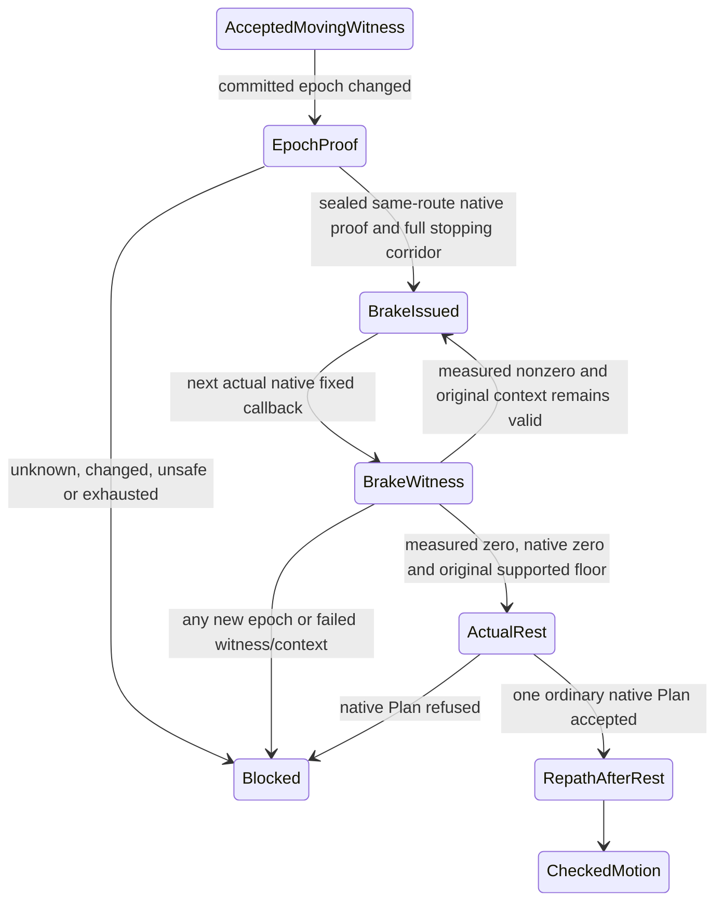

# API and recovery decision020

Architecture C remains bench-only: RustNav plans, the original ScientistNPC : BasePlayer retains its original radius0.5/height1.8 capsule and Rigidbody, and the existing checked MovePosition path is the sole actuator. No teleport, collider/body changes, velocity setter, permission bypass or default promotion.

## Final report contract

The completed bench report references the immutable `plugin-result.json` through `TRAVERSAL_PRIMARY_REFERENCE_V1`: schema1, fixed relative filename, run token, numeric byte length and SHA256. Saving shallow-copies the envelope while excluding Navigation; the original in-memory tree remains available to validation. Missing, changed or mismatched artifacts yield a small failed export instead of a deep fallback. The reader verifies plain paths, policy/marker, bytes before and after reading, strict UTF8/NUL and the parsed primary run token. Legacy inline bench reports remain readable; WorldRoam/Avatar/FirstHome/RESTORE retain the prior Depth8 representation. The final save is inside the existing cache-lock try/finally.

The actual large-file proof uses a new offline derivative and exact copied primary bytes. It neither repairs the original stale START10 wrapper nor reconstructs its lost final fields. Physical claims come from the original primary and independent raw audit, not that derivative. Four post-live PS changes are bounded offline report/validator corrections; all five physical C# inputs and the installed compile input still match actual START10 byte-for-byte. No new native run or architecture decision is needed for these changes.

## Native probe projection and audit provenance

The native read-only direct probe already projects Goal-position ontoXZ before normalizing. Replay now checks this same aim, exact zero probe vertical displacement, finite nonzero XZ directions and the unchanged0.99999 cosine threshold. Full3D native path length/corners/legs and actual capsule travel, exterior footprint, support, contacts, closed Door and measured rest keep their existing independent checks. Synthetic flat/up/down positives and six azimuth/vertical/zero negatives are offline tests, never physical certificates.

The first original-primary audit rejects unsafe1572 and passes the complete1571-witness prefix, but its old3D-aim predicate fails on the sloped goal. That failed callback and log remain frozen. A second original-primary parse completes the corrected G4 audit; it reuses the first physical-prefix proof only on identical raw hashes and all83 unchanged unrelated validator-function bodies. A write-once second-attempt marker and exact script/source bindings preserve honest total parse count2. Native G4 passes; later unsafe witness and optional G5 stay blocked.

## Installed API basis

Independent metadata/IL and hash audit binds the installed Assembly-CSharp SHA256 `04FB89520F18A1920C1B1A350B82DD24A4258F31D97B82496971A9CC7A49DCB7`, Unity PhysicsModule `8C14EB5CB74477ABBD1F043F26D9A4E58BB3E4ED7DDA1B81937E59D08967EA11` and Oxide.CSharp `B64977609A31FBE0C462626D966BC7C6818A06725D085F7CC2D2951FBC2B9094`. Thirteen installed modules match the owner snapshot; ten historical metadata/IL artifacts remain unchanged. The reviewer also checked the installed public Vector3.MoveTowards signature/implementation. Installed C#7.3 compilation is separate from actual live Oxide load.

Existing APIs are reused: Rigidbody.MovePosition/linearVelocity, native fixed/wall clocks, full sphere/capsule casts and penetration, RustNav exact-mesh/actor paths/poly refs/epochs/filter, native Planner.DoBuild, Construction/socket previews, loaded Item UID debit, Wood upgrades and native TC/Door/accounting. No DLL is executed by the metadata reader. Global PendingTiles remains visible; initial/site/build admission remains strict. Pending=true continuation is not claimed without actual live evidence.

## Root cause and finite state transitions

Frozen019 primary confirms command649 at speed0.8886592m/s, dt0.0625, then NO_BOUNDED_SUPPORTED_TRAJECTORY, REPATH with no new writer and the correct CLOCK_UNOBSERVED_ACTIVE_HOLD stop. Original raw remains unchanged and unsafe PARTIAL. An annotated private two-row copy is rejected by the new moving-repath contract; five hypothetical bounded deceleration steps demonstrate only kinematics. Historical support/collision geometry cannot be reconstructed as a safe braking corridor offline.

The chosen routine repair is measured braking, rather than a second actuation or route policy:

```text
ACCEPTED_MOVING_WITNESS
  -> current route/support failure
  -> BRAKE_REQUESTED
  -> complete supported free braking corridor + fresh current native admission
  -> BRAKE_ISSUED (one checked MovePosition)
  -> next fixed-step MOTION_WITNESS + BRAKE_WITNESSED
  -> another decreasing-speed command, or measured zero/native zero
  -> ACTUAL_REST
  -> fresh native replan + REPATH_AFTER_REST
  -> ordinary checked movement

unknown/unsafe corridor, changed context or exhausted budget
  -> explicit BLOCKED, no new actuation and no claimed physical stop
```

Every prospective step follows measured full3D momentum with Vector3.MoveTowards toward zero at3m/s², leaving the original4m/s² bound unchanged for actual quantization. No floor snapping constructs a braking velocity. Up to eight steps and one second per destination; current callback sequence, route handle/epochs/filter, original body, native prior velocity, clock and floor identity/owner/type/prefab/layer/bounds remain bound. Native current-route first-leg alignment remains mandatory; empty physical space alone is insufficient.

Before each issue, fresh native geometry checks cover all projected deceleration segments through zero and a supported reserve of at least v²/(2*3)+v*dt+skin. Full original capsule sweeps/overlaps, support, permission, water and vertical limits apply. The reserve follows measured momentum, not an arbitrary extra path length. Unknown geometry, unsupported/foreign/closed-Door corridor or insufficient budget receives no new writer. Query limit64, evidence limit16384, callback horizon0.1s and route deadline120s remain unchanged; query exhaustion is an uncertainty/budget stop, not proof of a physically solid wall.

The writer is shared with ordinary checked movement. A fresh post-sink native guard precedes issue; a scene sink refusal produces explicit MOVE_REJECTED/NOT_ISSUED without pending metadata, writer or actuation credit. Every accepted braking command requires the next actual native pose/velocity/support/sweep witness, including the last zero command and original floor fingerprint. Only that witness can create ACTUAL_REST. SetDestination requires exact measured/native rest and no pending/acquiring/braking work. MotionSession changes are bound to new native stationary baselines; recovery retries never reset inside a route.

CLOCK_UNOBSERVED_ACTIVE_HOLD remains an unchanged negative guard. Missing a command while moving never creates rest, new clock admission or a successful recovery. Failed stopping-space admission is explicitly NO_SAFE_BRAKING_TRAJECTORY; stopping the controller does not assert that a physical body safely decelerated.

## Explicit diagnostic live recovery request

The shortened exterior fixture can avoid the old pathological approach entirely. To obtain genuine recovery evidence without repeating34m, one HOME_SITE moving witness at speed>=0.4 may queue DIAGNOSTIC_PLANNED_REPLAN. QueueMeasuredReplan only records intent inside the accepted witness callback; it cannot plan, actuate or reset anything. The same Tick consumes it after updating measured velocity, then uses exactly the same corridor/brake/witness/rest gates. After observed rest it asks native Plan for the same destination. This proves the finite recovery mechanics only if actual live receipts pass. It is never wall/closed-Door/obstacle credit and does not prove frozen649 geometry was recoverable.

## Native fixture and report policy

The bench policy MINIMAL_G4_BEFORE_TC_V1 uses existing native placement/payment with order FOUNDATION, WALL_N, DOORWAY, DOOR; G4 probes/exterior detour precede TC. TC is subsequently attempted through the still open east side, followed by WALL_E/WALL_W/ROOF and full native authorization/upkeep/G5. HomeSchema and ordinary FirstHome construction order remain unchanged. No door is opened without the existing own-TC authorization gate. Partial four-entity geometry is explicitly a diagnostic fixture, not a complete house.

Build approach plans use dynamic foundation-local expanded footprint, native paths and at most three exterior legs, with actual observed rest before each destination. Predicted pre-foundation terrain/path graphs are not actual structure evidence. Fresh geometry/native checks follow every paid placement, and per-command exterior admission prevents later motor replans from cutting through the foundation.

The initial P2 experiment retained the embedded wrapper with bench-only depth60 and legacy depth8. Offline PS5.1 from immutable019 proved deep numeric vectors and semantic equality at4.878s/185169603bytes; the entire multi-tree process peaked at2.57GB. START10 later exhausted memory on the larger native report. The final primary-reference contract above supersedes this embedded-depth decision; historical raw and restore consumers remain unchanged.

At this document's initial creation, all physical020 outcomes remain NOT_TESTED; source/API/offline evidence is not GREEN_TRAVERSAL_CORE. Live receipts and final independent review will be reported in RESULT.md.

## START1 measurement and bounded prelive2 correction

Actual native compilation/load and readiness270.871s passed. All209 issued/accepted witnesses independently pass the physical prefix contract. Diagnostic brake170–172 produced0.312572181→0.125097245→0m/s after the triggering0.5000565m/s witness, actual/native zero, fresh same-destination replan and continued movement173–209. This proves diagnostic recovery mechanics on that actual support, not recoverability of frozen649 geometry or a native obstacle scene. Five crafts, zero placements/G4/G5.

The sole stale row was BLOCKED210/NOT_ISSUED, after the accepted209 witness in the same callback, with read delay0.6390147s and eight casts; no intent/issue210 existed. Original runner FAILED because the generic telemetry validator also rejected this terminal diagnostic. Full primary and secondary vectors/Navigation semantics match. Original raw/status remain immutable; separate revalidation can establish honest PARTIAL and preserve the209 accepted witnesses.

Prelive2 adds only a narrow terminal diagnostic allowance: exact penultimate no-actuation refusal, pending absent, same accepted moving callback/body/profile/session/route, next unused command, followed solely by an unclocked STOPPED snapshot. The original clock/watchdog remains required; diagnostic delay is bounded by1.5s. Late physical intents/issues/witnesses remain limited to0.1s. No actual rest, new movement, arrival, completed traversal or GREEN can arise from this exception. A later native velocity0 in the unclocked terminal snapshot remains UNKNOWN and cannot replace witnessed braking or reset lastVelocity.

The0.639s pause's attribution to logging, GC, native path or scheduling remains UNKNOWN. Full-frame duplicate console JSON was a confirmed hot-path allocation/I/O cost while the same complete dictionaries already remained in primary evidence. COMPACT_CONSOLE_FULL_PRIMARY_V1 retains every sink admission/decoration and complete primary frame, but serializes only compact progress to console. A strict clock checkpoint after the probe sink precedes new native work; failure-only probe/native/validation phase timestamps and exact predicates distinguish future refusals. No time/physics/route tolerance is raised. Independent source review and RED→GREEN/Test-All/C#7.3 are required before START2; compaction is not a guarantee that the fixture will be reached.

## START2 measurement and caller qualification

START2 retained165 complete issued/accepted native witnesses and actual arrival/rest, independently validated through that prefix. Before the first HOME_SITE baseline/command, the native sample reported Delta0.0625 and UnscaledDelta0.065741 at TimeScale1. The original actor/body/pose and actual/native zero were unchanged. C correctly refused that inconsistent clock; the source does not explain the engine's discrepancy. The frozen runner FAILED and raw are preserved, without treating the invalid sample as a physical step. Compact logging retained all495 complete primary motion intent/issue/witness rows.

STATIONARY_DESTINATION_WINDOW_V1 repairs only caller admission. A new goal queues without SetDestination or any actuator, only for an initially warmed never-started C or after a complete actual zero/native-zero witness and arrival. C must be inactive/unblocked, every earlier writer witnessed, native velocity exactly zero and original body/pose unchanged. The pending intent prevents old Arrived from advancing HomeArrived, a build, probe or waypoint. At most64 goal qualifications per bench; each has an immutable20s/512-observation budget and requires a contiguous2s native wall/fixed/unscaled window under the existing strict rules. Invalid samples receive no credit and end only eligibility, with no C/body/velocity/clock/budget reset. A timer watchdog also stops missing-FixedUpdate cases.

Only after READY does the caller invoke SetDestination once. It then reads the real native clock again in the same actual FixedUpdate, retaining sequence/frame/fixed values/profile while allowing real wall time to advance. This avoids a forged earlier start wall. The original READY callback remains the horizon: actual final CheckedWall before C.Tick and actual TickCompletedWall after its baseline-only return must both fit0.1s and the unchanged total/global deadlines. No work is hidden by wall recapture. Any overrun, changed state or actuation during the baseline handoff stops C without retry; a truthful baseline may remain diagnostic evidence without licensing later motion.

The independent validator replays every observation using the unchanged startup-window rules plus exact queued pose/native-zero/counter checks. Its temporary derived view subtracts an independently verified actuation baseline without mutating raw. It binds prior-rest clock/time/pose, goal, actual handoff and C baseline; reconstructs the original native Single global deadline from spawn sample+900s; forbids later progress/payment/proven scenes and completion after terminal qualification. Failure snapshots may retain real changed state but cannot create rest or movement credit. C's active physics/clock checks are unchanged byte-for-byte from START2.

G4_PRIORITY_V1 goes from the original initial warmup directly to HOME_START. It does not manufacture outdoor up/down scenes or relabel historical slopes; the real home-site approach remains physically checked. The priority is paid native obstruction/refusal/exterior detour, then safe optional full home. This is routine caller orchestration inside the approved C architecture, not a replacement actuator or clock policy.

## START3 measured stop and native preview re-admission

START3 independently retained317 complete native commands/witnesses and16.508m, measured diagnostic braking13–15, exact actual/native rest, native replan and subsequent actual HOME_SITE arrival/rest317. No placement occurred: preflight rejected its composite foundation preview predicate before payment. All ten raw files and original PARTIAL/FAILED statuses remain unchanged. Native compilation/readiness and source/runtime/API identity passed; this is still no G4 proof.

The offline runner also exposed a representation defect: TraversalDestinationHandoff captures the typed native TraversalClock without a Schema member; the physical C CLOCK_BASELINE uses ClockRow with Schema2. Assert-TraversalCapturedClockSame derives only that representation tag for this single typed-capture binding. It requires every original native numeric field and typed flags, requires physical frame Schema2, rejects an explicit invalid capture schema and invokes the unchanged generic clock equality. Tests reproduce the old error using the actual two shapes and deny missing/tampered native fields or physical schema. Full primary/secondary validation and exact Navigation equality then pass separately, with1560 plans/6240 numeric triplets preserved; frozen results are never rewritten.

Installed Socket_Terrain.DoPlacement derives the terrain placement rotation from the horizontal planning ray and native normal/socket parameters. HomePlace calls Planner.DoBuild using the real actor eyes. START3's accepted actor rest differs from the requested point by0.081522m horizontally; derived horizontal ray yaw differs by0.968369°. Since the original throw combined preview availability, position and rotation without individual values, yaw mismatch is an explicitly labelled inference. The correction must re-run existing complete site admission with actual stationary eyes before any foundation debit, then require a fresh actual preview against that newly admitted geometry with the same0.05m/0.05° limits and fresh exterior graph. No tolerance increase, pose snap, free placement or C change follows from this decision.

ACTUAL_FOUNDATION_READMISSION_V1 reuses HomeCheckSite with an optional actualStand mode restricted to the bench. Default ordinary admission and HomeSnapshot schema remain unchanged. The future sampled entrance stand and real native complete route remain meaningful; only the preview ray uses the exact current actor eyes. Native sample, terrain rays excluding self, original full capsule overlap and water queries validate the existing actual stand without moving it. All original terrain/height/water/topology/monument/foreign/permission/collision/access/deadline checks run before updating the admitted site. Current foreign structures are enumerated again while the original foreign fingerprint must remain unchanged.

Before payment, the original body/pose and actual/native zero are bound to the last complete accepted witness, with every writer witnessed and C inactive/unblocked/arrived. The exterior prediction is rebuilt from the newly admitted native preview; prediction never becomes physical proof. After Planner activation and the CanBuild hook, a fresh preview must meet the unchanged0.05m/0.05° bounds. Typed native preview eye/ray inputs are frozen and must equal both the actual payment target ray and current real eyes. Readiness/no pending and the same measured rest/body are checked again within a total0.5s prepay budget. The returned paid native foundation must also match admitted geometry before another build role can start.

One FoundationAdmission journal preserves the old hint, actual stand, original rest/support/body, before/accepted site, native preview/ray, individual deltas, graph interval and prepay gate. Immutable PrepayAccepted survives a later real paid partial failure; final Accepted=false/Reason records that failure without erasing materials, ledger entries or created entities. No rollback, paid retry, free spawn, actor adjustment or active-clock exception is introduced. This remains source/offline evidence until the next actual native placement.

## START4 native construction and goal readiness

START4 actually created and paid native FOUNDATION and WALL_N, then Wood upgrades; all four ledger operations and572 physical commands independently validate. The original actor reached five actual rest/arrival boundaries, including exterior construction legs. Native actual-ray site re-admission and later goal handoffs are now observed, while wall/Door refusals and exterior G4 detour remain open.

Immediate BuiltFoundation metadata had cachedStability0/Support=false, with truthful owned registered Wood/Grounded/health metadata. The later final row of the same native entity/building had cachedStability1/Support=true. Requiring the final supported-state predicate in both temporal samples was a validator error. The instant row now retains finite nonnegative cache/support consistency and exact native identity/geometry/grade/save/health without support credit; the final row still must be supported with positive native stability. Actual loaded costs and BUILD/UPGRADE UID debits remain mandatory. The original raw FAILED/PARTIAL statuses are preserved.

The sixth destination qualification retained actual/native zero and valid strict clocks, but its sole SetDestination returned false in about0.979ms, with no baseline or command573. The first STOP retained the previous route and reported PendingTiles=true. C.Plan refuses uncertain native readiness before committing a new route; the aggregate UNKNOWN_ROUTE_OR_BODY does not identify whether pending was read initially or after native path queries. This is a native-admission refusal, not clock jitter or moving active-hold.

NATIVE_NEW_GOAL_READINESS_V1 adds only caller eligibility for a new route while already measured at rest. Existing native availability/default mesh/default-built/no-pending/on-navmesh facts are captured with actual read times and reasons in each observation. Unknown/unready samples end only the contiguous eligibility span; no C state, body, velocity, original20s/512 budget or global deadline is reset. Only a contiguous2s strict clock plus native-ready span can reach the same single SetDestination. The existing original-callback0.1s handoff horizon includes the new read costs. A race at C.Plan remains an explicit terminal refusal without retry; no new active-route/poly policy is introduced. Older clock-only journals remain validated by their original contract.

## START5 fixture stand discovery

START5 physically passed723 complete commands and seven actual arrivals, paid the four-role native fixture and all seven build/upgrade operations. Native new-goal eligibility actually observed46 pending WAIT samples and subsequently admitted a goal with continued movement. Full primary and secondary validate independently with3528 plans/14112 numeric triplets and exact Navigation/polygon semantics. Active PendingTiles=true witnesses/certificates/issue guards were all0 in this run; there is still no physical proof for that separate active-route mode. No G4 scene or probe occurred before honest PARTIAL at stand discovery.

The existing Reach() comment explicitly documents that Ground is a pre-spawn candidate query and a downward ray through a live BasePlayer hits its own capsule. FixtureStandAt used NavSample→Ground after the actor occupied the doorway approach, including a smaller0.45 capsule and self-inclusive ray/overlap. Its three doorway inputs are about0.10/0.27/0.16m from the actual actor axis versus original radius0.5. Source defect and the corrected local analogue are concrete; the exact historical failed role/cast remains unlogged and is not retroactively asserted.

FULL_BODY_SELF_EXCLUDED_STANDS_V1 reuses TraversalBuildSample for fixture-only eligibility. It retains its bounded native sample, actual terrain ray, original0.5/1.8 capsule, all-layer mask, water threshold and unchanged expanded exterior footprint. Only the original actor's own colliders are excluded from safety selection; other owned entities and actors still block. Optional diagnostics retain actual raw self hits, selected terrain and actual overlap results from those same queries, at most three offsets for each of WALL_N/DETOUR/DOORWAY. Unexecuted stages remain absent/null. This creates no motion, rest, step or G4 success credit; actual later checked movement/probe proofs remain required. Source and offline tests are not a new live stand/G4 claim.

## START6 epoch boundary and bounded design decision

START6 independently validates1061 complete native commands, four native roles/seven build-upgrade debits and a target-bound wall PROBE_REFUSED with identical control state and136 subsequent accepted witnesses. Three witnesses and two fresh admissions/final guards actually observed global pending=true before the epoch boundary. No closed-Door probe or completed exterior G4 detour occurred. Full primary/secondary validate, with5161 plans/20644 numeric triplets and exact Navigation; frozen raw/status remain PARTIAL.

Issued1061 had recorded epochs42173/1480; its actual witness retained measured speed0.8890006m/s while global Change/Data became42220/1527. The published native handle remained equal; post-change managed default-mesh object identity, old refs/current path validity and physical braking corridor were not queried and remain UNKNOWN. The current epoch guard stopped before RequestBrake/CheckBrakeCorridor, so this is an uncertified native braking context, not measured proof of a solid or unsupported corridor. Subsequent diagnostic versions already advanced again. Pending warning provided only0.125 physics seconds at about0.889m/s, below even the4m/s² minimum stopping time0.222s; proactive brake-on-pending and an arbitrary extra wait cannot establish safe rest for this episode.

Independent design review permits a narrow same-committed-route proof path inside architecture C. Only one native committed leg and one proof attempt per original destination are eligible, directly after an accepted moving witness. Real current object equality plus nonzero identical handle/profile/filter, dual original-origin→same-goal queries reproducing exact old refs/corners, current validity of all old/fresh refs, and actual-pose→same-goal ordered suffix/remaining geometry must be freshly proven under stable new versions. The fresh first leg must contain every projected original3D braking/reserve endpoint. Full support/capsule/sweep/overlap/water/permission/static-floor checks run once; the original0.1s/64-query/4m/s²/8-step/1s/recovery/route budgets remain.

The old committed RoutePlan/from/to/index/polys/epochs stay immutable historical provenance. A separate current admission proof may license the same braking geometry only after all native and physical checks seal successfully; old rows are never retagged. Ordinary supported writer and post-sink final native guard remain authoritative. No new path/direction/goal commit, SetDestination, clock/counter reset or velocity write occurs while moving. Changed mesh object/handle/profile/filter/refs/geometry, dirty/late proof, unsafe floor/corridor or a second epoch change during braking remains BLOCKED. New ordinary Plan is allowed only after genuine supported/native exact zero; pending refusal at that point is still terminal, without hidden waits or retries. This design is not proof that START6 could have braked.



EpochProof creates no rest or movement credit. BrakeIssued requires the original physical/native writer admission; BrakeWitness requires the matching actually issued command and measured3D velocity. ActualRest requires that final witness, never an unclocked cleanup snapshot. Only RepathAfterRest can resume ordinary movement. Implementation/code review/offline regressions and new live evidence remain required.

The implemented controller also closes two independent source-review findings before any new native start. NATIVE_POST_SINK_VELOCITY_V1 records a real native velocity read after the decision sink and compares it with the last accepted measured3D velocity under the existing0.001 bound; it does not compare only against a previously sampled native vector. Expected velocity is independently reconstructed during replay from the last accepted physical witness, or the verified initial zero baseline. Native exceptions, nonfinite readings and sink cancellation remain explicit no-writer diagnostics with unknown/unexecuted observations left null. The sealed floor context rechecks attachedRigidbody==null as well as its original fingerprint and bounds, preventing a formerly static floor from acquiring a body unnoticed. These changes add no physical query, actuator, tolerance or budget waiver. Both independent C source reviews and installed C#7.3 pass; final merged receipt/full tests and live proof remain required.

## START7 measured boundary and bounded series decision

START7 physically sealed the same-route proof after witness1059. Real object identity, unchanged native profile/filter, exact original six refs/corners and the current one-ref suffix passed, including current validity before/after the full projected stopping corridor/reserve of0.207275331m. Command1060 actually reduced speed0.888979554→0.7014789m/s at3.000011m/s². All1060 physical witnesses and new post-sink velocity guards independently pass. A second epoch then changed; its current refs/path/corridor were not queried. Their safety remains UNKNOWN, and the original one-proof implementation correctly ended BLOCKED before Door. The unclocked cleanup zero supplies no rest credit. START7 primary remains PARTIAL and original wrapper FAILED.

The wrapper failure is independently reproduced as a PS5 numeric representation bug. Source clock/readiness/observation fields are native Doubles; ConvertFrom-Json may materialize their decimal spellings as Decimal. Converting only start/completion to Double caused175 false mixed-type comparisons across473 valid observations. The correction passes all four endpoints through existing Get-TraversalNumber before the same strict inequalities, with no tolerance, Bench timestamp change or native API change. Focused actual-shape/true-regression checks pass; final full-result revalidation is recorded separately and never rewrites historical FAILED bytes.

Measured-engineering decision: refine only C's existing checked brake into a bounded series of fresh same-committed-route proofs. Independent design GO finds this within the owner's authorized architecture C, not an actuator/controller change. Original actor/body/sole MovePosition/RustNav and every native/physical/time limit remain. Old committed plan/from/goal/refs/corners/epochs and the single original brake context stay immutable.

Each further proof requires a newly accepted nonzero brake witness in the same callback, no pending writer, unchanged original floor/body/clock, and all original dual old-origin/current native queries, exact geometry/current refs and full remaining3D corridor/reserve. One attempt per witness/callback, at most eight attempted proofs within the same eight-step/one-second recovery; the remaining projected steps/time must fit the original unused allowance. No CaptureBrakeContext reset, steering, moving Plan, clock/counter reset or repeated BRAKE_REQUESTED is permitted. Native or physical uncertainty and any during-query/sink race still end BLOCKED. Proof ordinal counts actual proof events and can differ from brake step when versions stayed stable between steps.

The new revision uses an explicit stream/profile policy and at most eight flat ordinal records. Scalar previous ordinal/command/clock/completion/admission-epoch links bind the exact prior accepted proof; committed OldChange/OldData never become previous effective epochs. Prior rows remain immutable. A failure may retain a rejected candidate alongside the last accepted navigation proof without granting an issue. No recursive previous-proof object or whole journal is inserted into each frame. Historical V1 retains its strict single-proof semantics.

An already accepted measured/native exact-zero brake witness may acknowledge physical rest independently of an obsolete navigation certificate, after original matched-command/body/static-floor/full-body/permission/water/clock/step/time checks. It never creates another zero MovePosition or proof. After the ACTUAL_REST sink, a fresh captured-rest guard must still pass; current native Plan and its post-query precommit guard must pass before any route/progress commit. Global pending/unknown native state remains terminal with no hidden wait/retry. Any epoch proof, epoch mismatch or diagnostic recovery uses fresh Plan to the original goal. Ordinary recovery with no epoch involvement preserves its existing Obstacle side-path behavior, adding the same rest guard after the sink and native queries before commit. Native/body/pose/velocity/floor/clock mutation cannot be hidden by resampling time.

Implementation and three grouped contracts are in progress in the existing controller/validator/test files. Installed C#7.3, complete Test-All, independent final source/replay review, historical compatibility and fresh live gates remain required before another native start. The bounded design does not prove the unknown second-epoch state was recoverable.

Prelive8 implementation is now frozen. Both independent C reviews and the final combined public-validator review report no open Critical/Important. Current installed C#7.3 and full Test-All pass. Source cancellation guards prevent a synchronous Stop in witness/proof/rest/route callbacks or native-query hooks from producing later control progress or route commits; accepted physical velocity/pose/time still update truthfully. Inactive read-only probe behavior remains unchanged.

V2 replay now binds flat predecessors, one original brake context, remaining step/time allowance, current exact-rest water/support/body/floor/clock, post-rest proof expiry and actual guarded replan completion. Historical V1 keeps its single-proof contract. A separate V2-only late-rest refusal predicate accepts a truthful no-writer diagnostic suffix after a previously accepted exact-zero brake witness, with no new physical/rest/replan credit. It preserves changed or unknown failure state. Future native payments, construction, waypoint rests, detour/portal/home progress, build graphs, new goals or scene completion are denied; earlier paid prefixes and final diagnostic snapshots remain valid. Native Single and Double artifact timestamps retain their actual source domains. The older moving refusal predicate and all successful/physical time limits remain unchanged.

Full fixed-validator revalidation of immutable START7 primary and wrapper and fresh before-start gates are still running. No new live proof, Door refusal, exterior detour or G5 result is implied by these source/offline passes.

## START8 stationary native race and C9 decision

START8 primary and actual secondary report independently pass572 physical witnesses and full2795-plan/11180-triplet fidelity. Its diagnostic brake/rest/replan was genuine; the new moving epoch-series path was not exercised. At the sixth destination, an admitted stationary baseline was followed by a native epoch change and pending=true at unchanged physical/native zero, before any new writer. Exact Plan refusal branch and new native object/ref/path validity remain unknown. The honest PARTIAL raw is preserved.

Root and independent review approve an explicit stationary native-eligibility FSM as routine work within architecture C. It accepts only a same-session baseline before its first writer or an already accepted physical brake-rest receipt. Physical braking retains its original eight-step/one-second bound; waiting is a separate read-only phase with no additional rest or motion credit. Every actual fixed callback preserves strict clocks, original pose/body/static floor, full capsule/support/overlap/permission/water and exact observed/native zero. Only native eligibility may restart the contiguous two-second stable object/handle/versions/profile/filter span, within one immutable twenty-second/512-observation total and original route/global/retry bounds.

The existing controller-only destination API receives an optional immutable global deadline from the existing bench caller. An absent argument preserves legacy behavior; an explicitly invalid argument must reject before state mutation. The existing half-second caller heartbeat may only stop an expired wait, without physics, native queries, Tick or fabricated fixed samples. READY grants at most one fresh dual native Plan with post-query physical/native/control/deadline checks before commit; subsequent writers retain all original guards. Separate revisioned replay binds both entry lineages and truthful no-writer terminal suffixes without relaxing historical V1/V2 or active-hold semantics. No new native API, actor, actuator, timer, layer or owner modification is introduced. Source/offline/live validation remains pending.

C9 source is frozen after root and independent C review with no open Critical/Important. Installed C#7.3 passes. Review closed the exact-body lineage across the baseline, accepted zero-brake witness, ACTUAL_REST sinks, stationary entry/window/query and first writer. One typed immutable body snapshot uses exact scalar comparisons; it is never recaptured to hide a change. The zero-witness snapshot is bound to its actual session/command/sequence before publishing that witness. Legacy body tolerances remain unchanged. An ENTRY guard checks existing current physical facts and the original callback horizon before STARTED; a rejected entry has only terminal diagnostics, with no new window, native Plan or physical credit. Completed physical recovery metadata is retained for a later guarded stationary replan, without extending the physical brake's clock. Public replay/full checks and native evidence remain separate pending gates.

Final public replay now passes root Test-All/installed C#7.3, independent full Test-Traversal and full frozen START8 primary/secondary compatibility. Its body/deadline/goal/counter/native facts are anchored to actual earlier frames, not merely agreeing copies. Independently replayed READY and the one committed Plan remain immutable through the first writer; the actual first command retains that committed route while its fresh per-command admission and later legitimate moving epoch proofs stay governed by the original rules. New-source shape detection prevents stripping the policy marker to enter legacy validation. Terminal-only handling distinguishes an unissued intent from a native pending writer, preserves truthful changed failure state and prohibits later motion/rest/paid/build/goal/scene credit. Unclocked failure time is bounded by its actual native-Single Stop timestamp. These are evidence-validation decisions; native C9 and G4/G5 outcomes remain to be measured.

Installed inner IL additionally confirms the existing RebuildTilesInBounds(bounds,true) path: JoinSaveForSynchronousMutation, main-thread collection, background work invoked synchronously, and native tile application occur before return. The wrapper also drains all queued door-nav reasserts synchronously; inspected leaves use actual Door state and do not physically open it. Void wrappers discard per-tile results, so invalid bounds, no-op or failed tile work cannot be called success, and no universal Change/Data increment is required. Root and independent review approve a bench-only caller experiment at the already paid, genuine inactive rest boundary with unchanged original deadlines and post-return original-body/zero/counter checks. Ordinary callers and controller/clock/writer/native path validation remain unchanged. Native execution cannot be preempted inside the call; after-return overruns refuse further work and the existing isolated owned-job runner provides containment. No claim links this call causally to the START9 clock failure.
